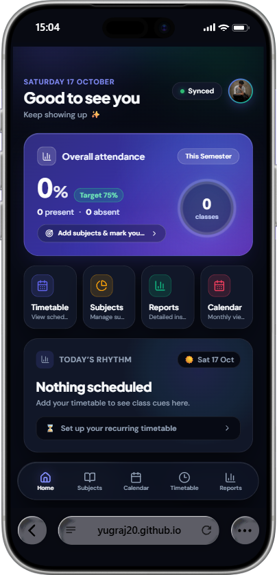
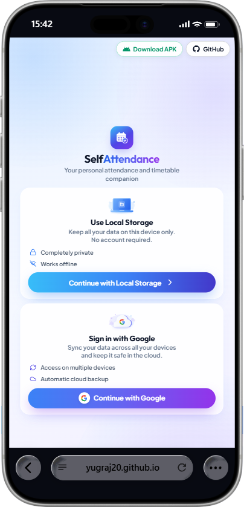
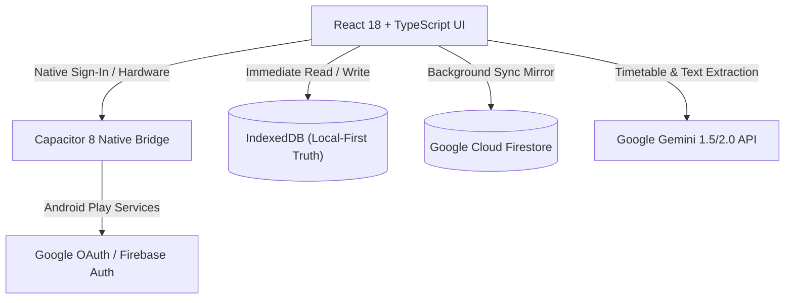

<div align="center">

# 🎓 Self Attendance

### *Smart, Local-First Attendance Tracker & Timetable Companion for Students*

[](https://github.com/Yugraj20/SelfAttendancee/releases/tag/v1.0.1)
[](https://github.com/Yugraj20/SelfAttendancee/releases/latest/download/SelfAttendance.apk)
[](https://yugraj20.github.io)
[](./LICENSE)
[](https://react.dev/)
[](https://www.typescriptlang.org/)
[](https://capacitorjs.com/)
[](https://firebase.google.com/)
[](https://buymeacoffee.com/yugraj20)

<br />

[**🌐 Open Web Application**](https://yugraj20.github.io) • [**📲 Download Android APK**](https://github.com/Yugraj20/SelfAttendancee/releases/latest/download/SelfAttendance.apk) • [**☕ Buy Me a Coffee**](https://buymeacoffee.com/yugraj20) • [**📖 Documentation**](#-key-features) • [**⚡ Quick Start**](#-quick-start)

<br />

<p align="center">
  
</p>

</div>

---

## 🌟 Overview

**Self Attendance** is a modern, privacy-respecting attendance tracker designed for college and university students. It operates **100% offline-first** using on-device IndexedDB storage so you never experience network lag. When you want your data to sync across your phone, tablet, and laptop, you can sign in with Google to mirror your records to a private, encrypted Firebase Firestore document.

Built with a high-end **Neo-Glass & Bento Grid** interface inspired by luxury productivity apps, Self Attendance calculates exactly how many classes you can afford to miss (*"bunk"*) or must attend to stay above your target percentage (e.g. 75%).

---

## 📱 App Screenshots

<div align="center">
  <table>
    <tr>
      <td align="center" width="50%">
        <b>📱 Mobile Dashboard & Today's Rhythm</b><br/><br/>
        <br/><br/>
        <em>Overall attendance progress ring, centered quick actions & active class cues</em>
      </td>
      <td align="center" width="50%">
        <b>🔐 Storage Mode Selection</b><br/><br/>
        <br/><br/>
        <em>Choose between 100% offline Local Mode or Google Cloud Sync</em>
      </td>
    </tr>
  </table>
</div>

---

## ✨ Key Features

### 🎨 1. Luxury Dark & Bento UI
- **Cinematic Midnight Atmosphere**: Deep dark midnight background (`#080A12`) with subtle violet-blue ambient aurora gradients.
- **Dynamic Attendance Ring**: Interactive circular SVG progress ring with multi-stop gradients reflecting real-time percentages.
- **Centered Quick Access**: Tactile, compact shortcut cards for **Timetable**, **Subjects**, **Reports**, and **Calendar**.
- **Responsive Floating Dock**: Glassmorphism bottom navigation bar tailored with mobile safe-area insets.
- **Theme Parity**: Complete visual parity across **Dark**, **AMOLED True Black**, and **Clean Light** themes.

### 🛡️ 2. Dual Storage Architecture
- **Local-Only Mode**: Everything lives solely in your browser's or device's IndexedDB. Zero accounts required, 100% offline, zero server calls.
- **Google Cloud Sync**: Sign in with Google (via native Google Play Services on Android or OAuth popup on web) to sync attendance across multiple devices via Firestore.
- **Zero Lock-In**: Switch between Local and Cloud modes anytime in Settings with automatic safety backups and an interactive 3-way conflict resolver.

### ⏰ 3. Today's Rhythm & Schedule
- **Live Class Tracking**: Automatically detects the current ongoing lecture or lab and displays time elapsed and minutes remaining.
- **Up Next Indicator**: Shows your next upcoming class with room numbers and teacher information.
- **One-Tap Attendance Marking**: Mark Present or Absent with instant visual feedback and a one-click **Undo** toast.

### 🧮 4. Smart Safe-to-Miss Math
- **Safe Misses (Bunk Calculator)**: Tells you exactly how many consecutive classes you can safely skip while remaining at or above your target percentage.
- **Recovery Requirement**: When in the risk zone, tells you how many consecutive classes you must attend to cross your target threshold.
- **Integer Precision**: Avoids floating-point rounding errors and protects against `NaN` or `Infinity`.

### 🤖 5. AI Timetable & Attendance Import (Google Gemini)
- **Timetable Scanner**: Upload PDFs, timetable screenshots (PNG, JPG, WEBP), and let Gemini AI extract subjects, times, days, and room numbers.
- **Attendance Export Parser**: Paste or upload unstructured raw text logs from college portals; Gemini extracts dates, subjects, and statuses.
- **Human-in-the-Loop Review**: Preview and edit every detected entry before committing to database.

### 📊 6. Reports & Data Portability
- **Excel Export (`.xlsx`)**: Generate comprehensive monthly or semester attendance spreadsheets with present/absent summaries.
- **Encrypted Local Backups**: Export and restore human-readable `.txt` backup payloads with pre-transaction validation.
- **Single-Click Wipe**: Remove all data from local IndexedDB and cloud Firestore with a single verified action.

---

## 📐 Mathematical Formulation

All attendance logic in [`src/math.ts`](./src/math.ts) uses exact integer math:

| Metric | Condition | Formula |
| :--- | :--- | :--- |
| **Attendance %** | $\text{total} > 0$ | $$\text{pct} = \frac{100 \times \text{present}}{\text{present} + \text{absent}}$$ |
| **Safe Misses ($B$)** | $\text{pct} \ge T$ | $$B = \left\lfloor \frac{100 \times \text{present} - T \times \text{total}}{T} \right\rfloor$$ |
| **Required Classes ($R$)** | $\text{pct} < T \text{ and } T < 100$ | $$R = \left\lceil \frac{T \times \text{total} - 100 \times \text{present}}{100 - T} \right\rceil$$ |
| **Unreachable Target** | $T = 100 \text{ and } \text{absent} > 0$ | Sentinel `-1` *(renders "Target 100% unreachable")* |

---

## 🛠️ Tech Stack & Architecture



- **Frontend**: React 18, TypeScript, Vite 6, Lucide Icons, Recharts
- **Local Database**: IndexedDB (native browser storage)
- **Cloud & Auth**: Firebase Auth (Google Sign-In), Cloud Firestore
- **Mobile Engine**: Capacitor 8 (Android WebView + native Java plugins)
- **AI Engine**: Google Gemini API (REST SDK)
- **Testing**: Vitest, JSDOM, Testing Library, fake-indexeddb

---

## ⚡ Quick Start

### Prerequisites
- [Node.js](https://nodejs.org/) v20+
- [npm](https://www.npmjs.com/) v10+
- *(Optional for Android build)*: [Android Studio](https://developer.android.com/studio) & JDK 21

### 1. Clone & Install
```bash
git clone https://github.com/Yugraj20/SelfAttendancee.git
cd SelfAttendancee
npm install
```

### 2. Configure Environment
Create a `.env.local` file in the root directory:
```env
VITE_FIREBASE_API_KEY=your_api_key
VITE_FIREBASE_AUTH_DOMAIN=your_project.firebaseapp.com
VITE_FIREBASE_PROJECT_ID=your_project_id
VITE_FIREBASE_STORAGE_BUCKET=your_project.firebasestorage.app
VITE_FIREBASE_MESSAGING_SENDER_ID=your_sender_id
VITE_FIREBASE_APP_ID=your_app_id
VITE_FIREBASE_MEASUREMENT_ID=your_measurement_id
VITE_GEMINI_API_KEY=your_optional_gemini_api_key
```

### 3. Run Development Server
```bash
npm run dev
```
Open [http://localhost:5173](http://localhost:5173) in your browser.

### 4. Run Automated Tests
```bash
npm test
```

---

## 📦 Building for Android

Self Attendance is configured with Capacitor 8 for Android:

```bash
# 1. Build the web distribution and sync Android project
npm run build:android

# 2. Build Debug APK using Gradle
cd android
./gradlew assembleDebug

# 3. Locate compiled APK
# Outputs to: android/app/build/outputs/apk/debug/app-debug.apk
```

You can download the pre-built, ready-to-install Android APK directly from [**GitHub Releases**](https://github.com/Yugraj20/SelfAttendancee/releases/latest).

---

## 📄 License

This project is licensed under the [SelfAttendance Proprietary License](./LICENSE). All rights reserved.

---

<div align="center">
  <b>Built with ❤️ for students who want to keep showing up ✨</b>
</div>
